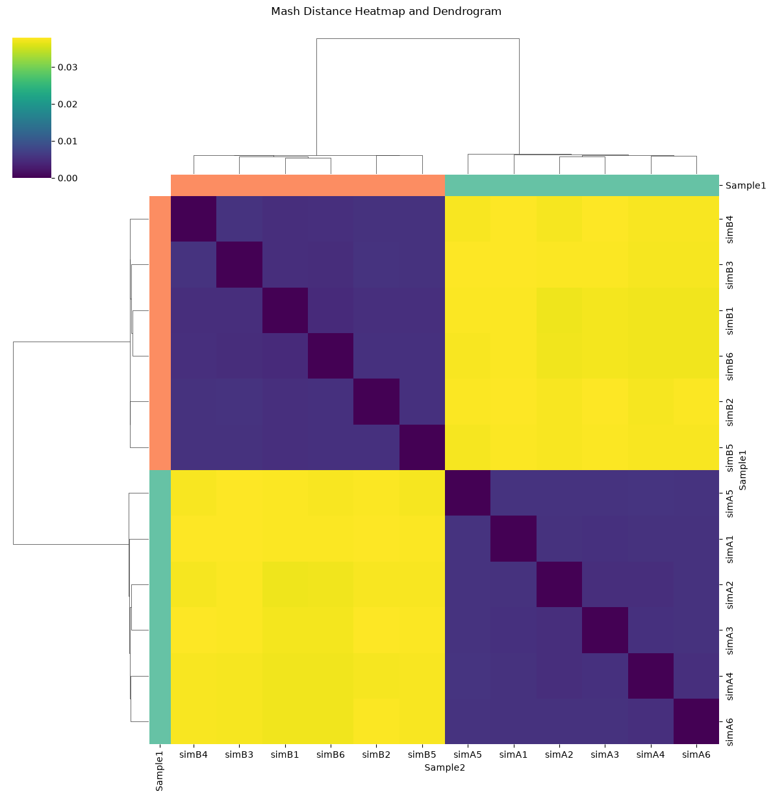
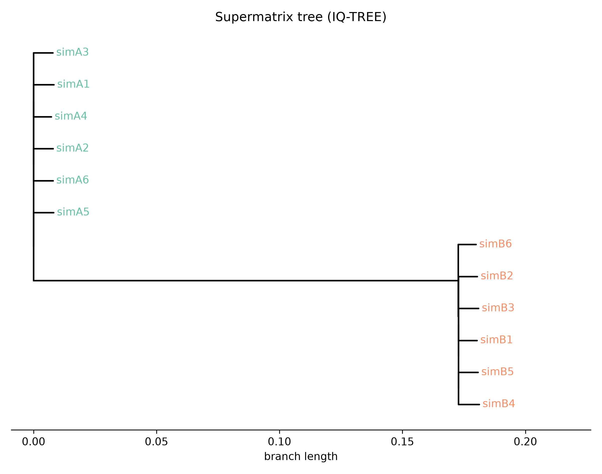

<p align="center">
  
</p>

<p align="center">
  
  
  
  
  
</p>

<p align="center"><b>A config-driven pipeline that takes paired-end reads all the way to assemblies, annotations, orthogroups and species trees.</b><br>
Built for comparing fungal isolates, reusable for any set of genomes.</p>

---

## Pipeline at a glance

<p align="center">
  
</p>

| Stage | What it does | Tools |
|:--|:--|:--|
| **1 · QC & Trim** | Read quality reports, adapter and quality trimming | FastQC, Trimmomatic |
| **2 · Assemble** | De novo assembly and assembly quality metrics | SPAdes, QUAST |
| **3 · Compare** | Genome-wide distances and average nucleotide identity | Mash, FastANI |
| **4 · Annotate** | Repeat masking and gene prediction | Funannotate |
| **5 · Orthology** | Orthogroups and gene-count tables | OrthoFinder |
| **6 · Phylogeny** | Single-copy ortholog trees; supermatrix, consensus and coalescent species trees | MAFFT, IQ-TREE, ASTRAL |

## Why this pipeline

- **One config, many steps.** Paths, thread counts, conda environments and sample lists all live in `bin/00_config.sh`.
- **Plain text samples.** List your IDs in `samples.txt`; nothing is hard-coded in the scripts.
- **Three tree methods.** Concatenated supermatrix, gene-tree consensus and ASTRAL species tree, side by side.
- **Publication-style plots.** Dendrograms, heatmaps, UpSet plots and QUAST bar charts, with optional group labels.
- **HPC friendly.** Plain Bash and Python, so it drops into a SLURM job script.

## Quick start

```bash
git clone https://github.com/it-Worked-on-My-MAC/fungal-phylogenomics-pipeline.git
cd fungal-phylogenomics-pipeline

# 1. reads go in ./reads as <ID>_1.fq.gz and <ID>_2.fq.gz
# 2. list your sample IDs
cp examples/samples.example.txt samples.txt

# 3. run the steps in order
bash bin/01_trimming_and_fastqc.sh
bash bin/02_assembly_spades.sh
# ... through bin/11_make_figures.sh
```

Optional group labels for the plots: copy `examples/groups.example.tsv`, edit it, and pass it as the last argument to the plotting scripts.

## Demo on simulated data

```bash
NO_CONDA=1 bash demo/run_demo.sh   # with all tools on PATH; use bash 4 or newer
```

This simulates 12 made-up isolates in two groups, runs the pipeline, and checks that the groups are recovered by ANI, Mash and all trees. **The figures in `results/demo_figures/` come from simulated genomes and say nothing about real biology.**

<p align="center">
  
  
</p>

## Run on public genomes (CAU cluster)

```bash
bash cluster/run_all.sh    # from the repo root, on a login node, inside tmux
```

This creates one conda environment per tool group, downloads 10 public *A. alternata* and *A. arborescens* runs from ENA (`cluster/public_samples.tsv`) and the Funannotate databases, then submits the full run as one Slurm job. Finished steps are skipped if you resubmit. Species labels are as submitted to ENA, so this tests the pipeline and is not a taxonomic result.

## What has been tested

| Part | Status |
|:--|:--|
| Steps 1–6 and 8–11 | Run with the real tools on the simulated data (one fixed IQ-TREE model in place of ModelFinder, for speed) |
| Step 7, Funannotate | **Not run.** The demo writes the known simulated proteins where step 8 expects them |
| Real fungal genomes | **Not run in this version** |
| `cluster/run_all.sh` | Written for the CAU cluster; not yet run there |

Tested with Trimmomatic 0.39, FastQC 0.13.0, SPAdes 4.3.0, QUAST 5.2.0, Mash 2.3, FastANI 1.34, OrthoFinder 3.2, MAFFT 7.526, IQ-TREE 3.1.4 and ASTRAL 5.7.8. The original MSc project used older versions of some tools.

This version was cleaned up and extended with AI assistance in November 2026, after the original project. Its changes include the ASTRAL step, adapter trimming, the Mash sketch size and the bug fixes, so it is not identical to the code behind the project report.

## Repository layout

```text
├── bin/        numbered pipeline steps (00_config.sh, 01_… to 10_…)
├── scripts/    Python helpers: ortholog extraction, supermatrix, plots
├── examples/   dummy sample list and group file (no real data)
├── demo/       data simulator, demo run and checks
├── results/    figures from the simulated demo
└── docs/       README images
```

<details>
<summary><b>Script reference</b></summary>

| Script | Purpose |
|:--|:--|
| `bin/01_trimming_and_fastqc.sh` | FastQC and Trimmomatic on raw paired reads |
| `bin/02_assembly_spades.sh` | SPAdes assembly of trimmed reads |
| `bin/03_quast_evaluation.sh` | QUAST report for each assembly |
| `bin/04_summarize_quast_results.sh` | Contigs, total length, N50 and GC into one table |
| `bin/05_mash_analysis.sh` | Mash sketches, distances and a quick tree |
| `bin/06_fastani_analysis.sh` | All-vs-all average nucleotide identity |
| `bin/07_funannotate_prediction.sh` | Contig filtering, repeat masking, gene prediction |
| `bin/08_prepare_proteomes_for_orthofinder.sh` | Collects protein FASTA files |
| `bin/09_run_orthofinder.sh` | Orthogroup inference |
| `bin/10_run_phylogenomics_pipeline.sh` | Single-copy orthologs, alignment, gene trees, supermatrix, consensus and ASTRAL trees |
| `bin/11_make_figures.sh` | Runs all plotting scripts |
| `scripts/plot_quast_metrics.py` | Assembly quality bar plots |
| `scripts/plot_mash_dendrogram.py` · `plot_mash_heatmap.py` | Mash dendrogram and clustered heatmap |
| `scripts/plot_fastani_dendrogram.py` | ANI-based dendrogram |
| `scripts/plot_orthogroup_upset.py` | Orthogroup overlap across species |
| `scripts/plot_tree.py` · `mash_nj_tree.py` | Tree figure and neighbour-joining tree from Mash distances |
| `scripts/extract_scos.py` · `extract_sco_seqs.py` · `build_supermatrix.py` | Phylogenomics helpers |

</details>

<details>
<summary><b>Required software</b></summary>

FastQC, Trimmomatic, SPAdes, QUAST, Mash, FastANI, Funannotate, OrthoFinder, MAFFT, IQ-TREE, ASTRAL, plus Python packages Biopython, pandas, matplotlib, seaborn and scipy. Conda environment names are set in `bin/00_config.sh`.

</details>

## Data policy

This repository contains **code and simulated demo output only**. No real sequencing data, assemblies, results or sample metadata are included. The files in `examples/` use dummy IDs, and everything from `demo/` is simulated.

---

<p align="center"><sub>Built by <a href="https://www.linkedin.com/in/mahmadtariq/">M. Ahmad Tariq</a> · MSc AgriGenomics, Kiel University</sub></p>
